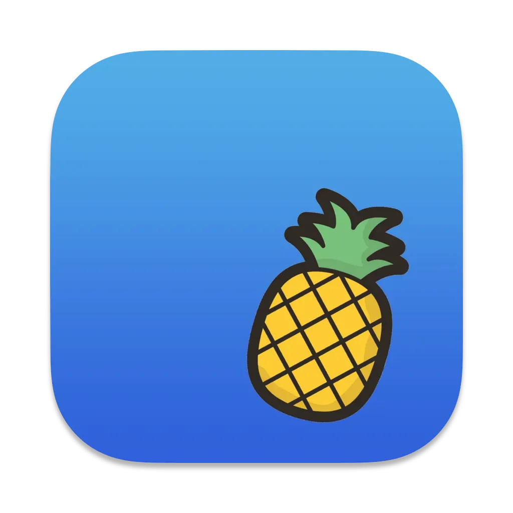
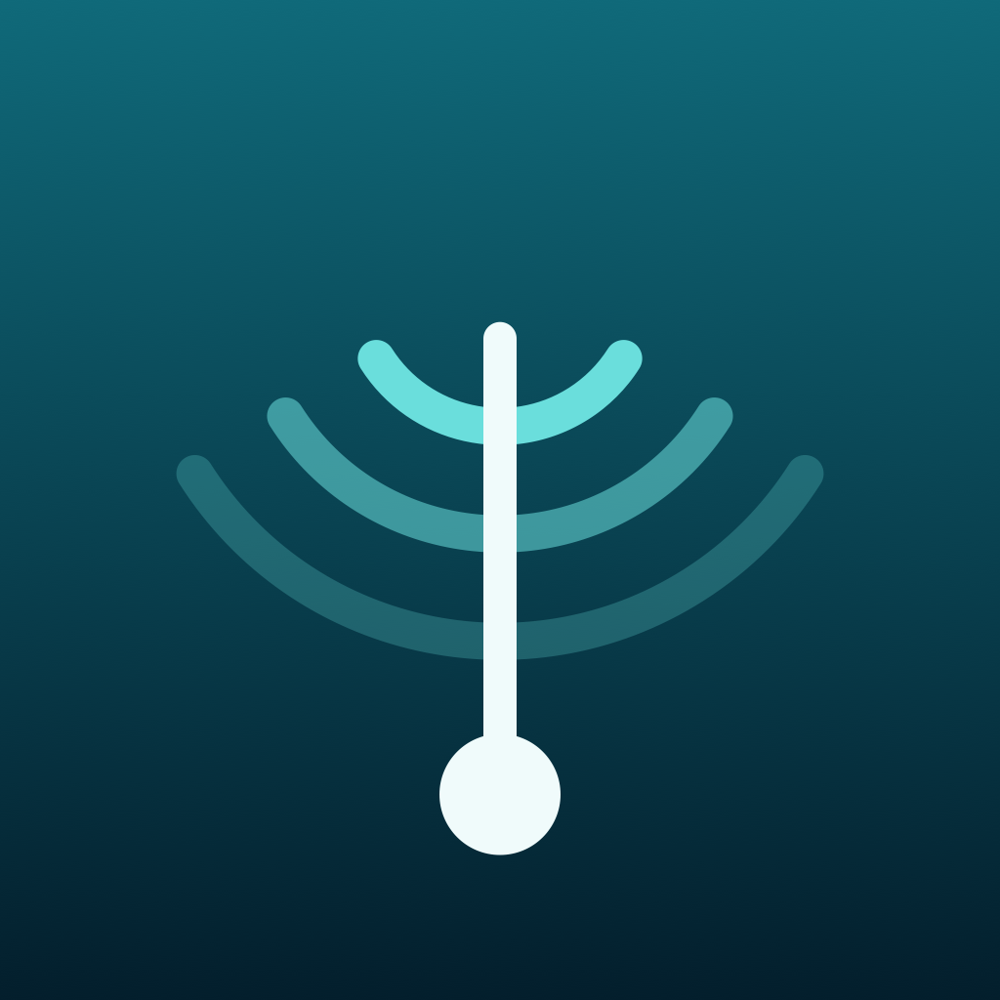
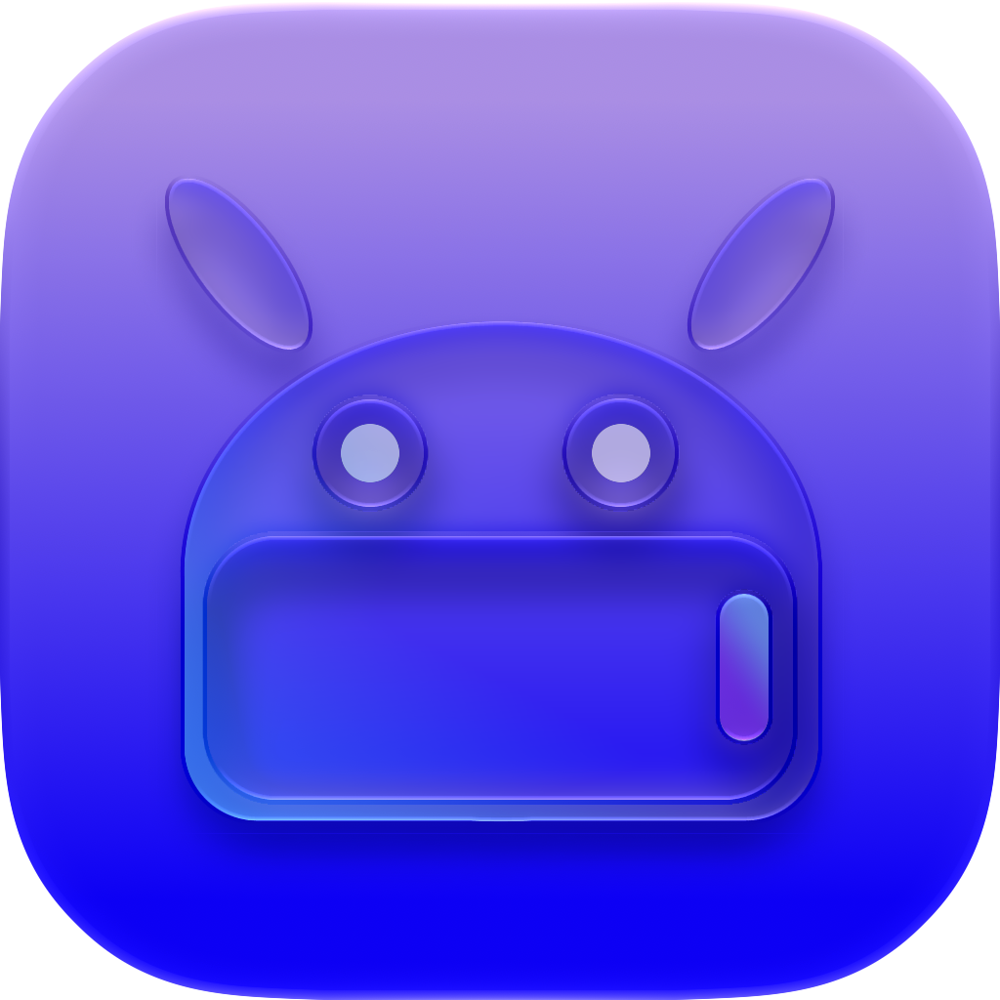
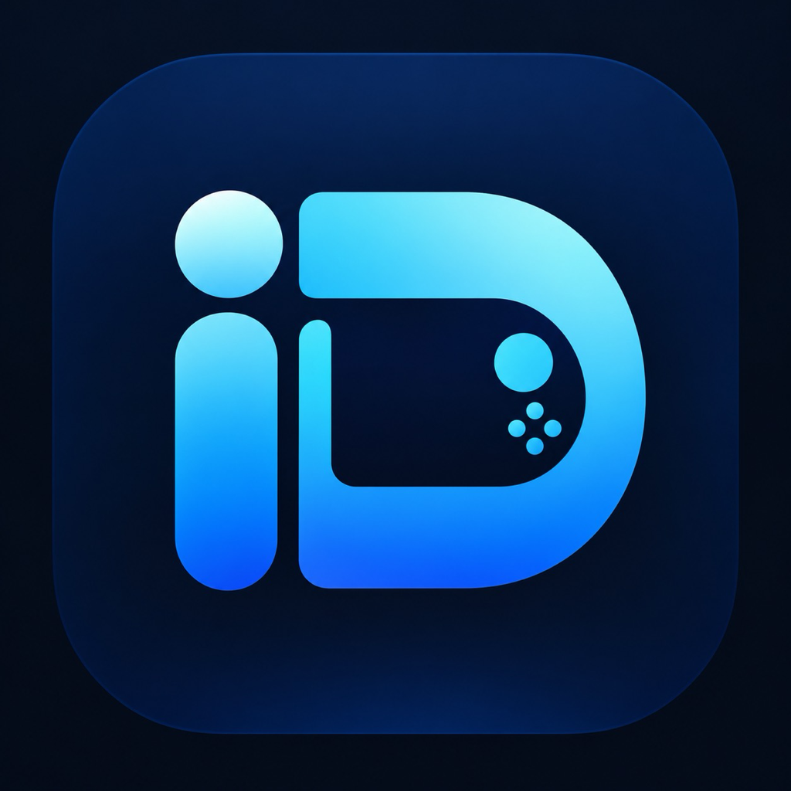
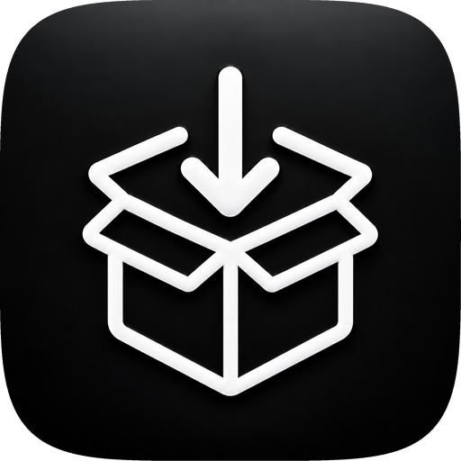
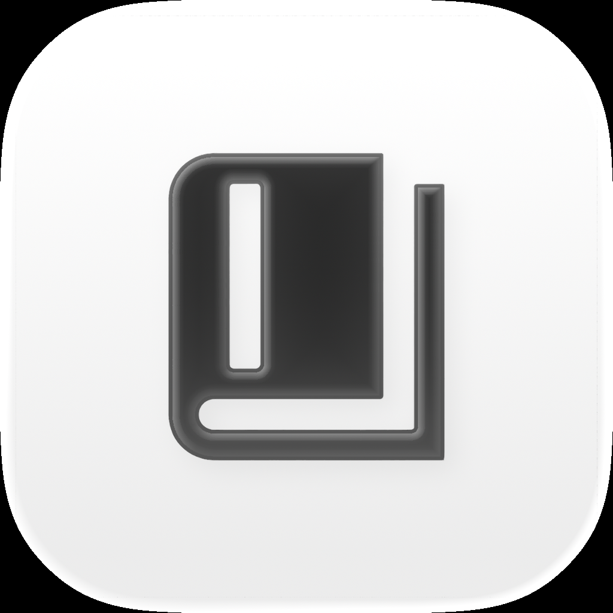
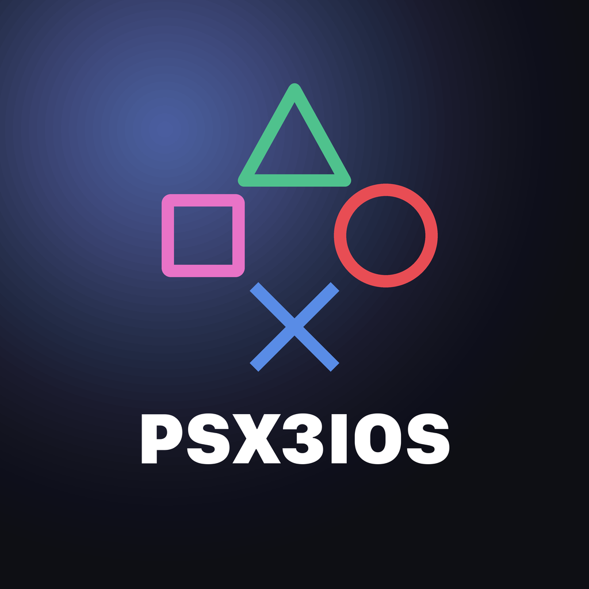
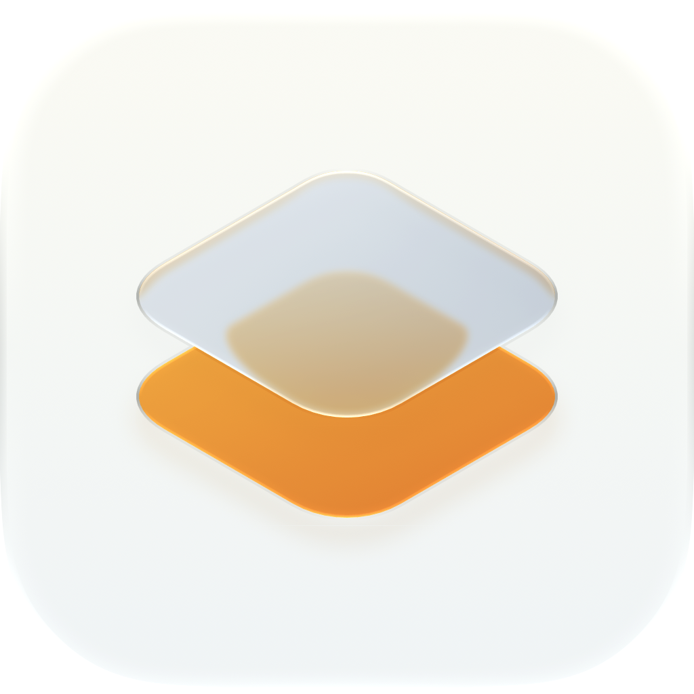
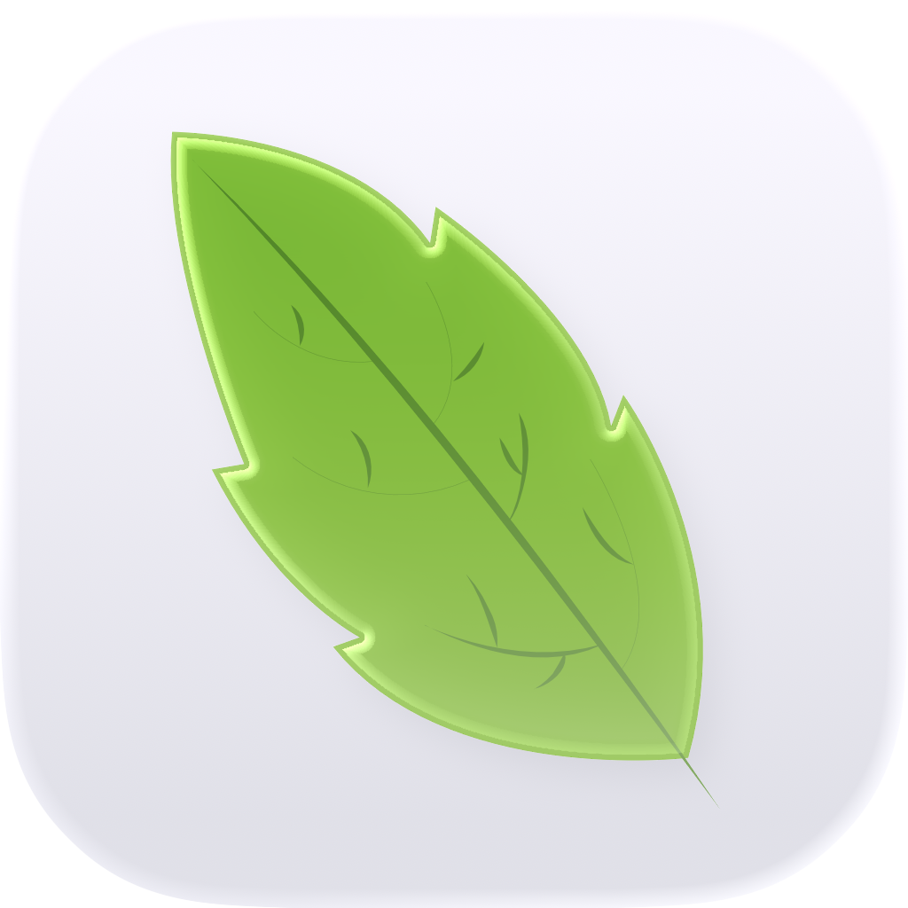
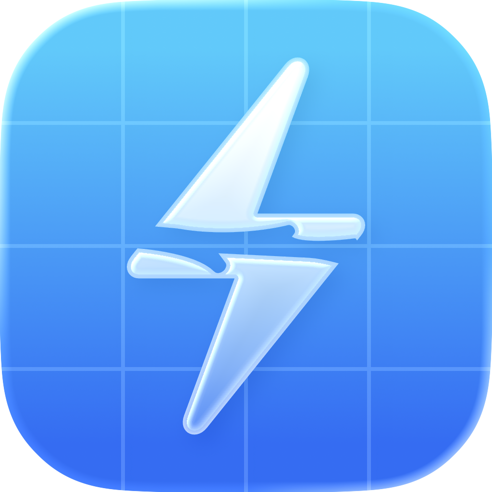

<p align="center">
  
</p>

<h1 align="center">AltGallery</h1>

<p>Curated AltStore sources for IPA projects on GitHub. All sources are generated in this repo with <a href="https://github.com/bebound/AltGen">AltGen</a>. It can be used with <a href="https://github.com/altstoreio/Altstore">AltStore</a>, <a href="https://github.com/SideStore/SideStore">SideStore</a>, <a href="https://github.com/LiveContainer/LiveContainer">LiveContainer</a>, <a href="https://github.com/claration/Feather">Feather</a> or other compatible apps.</p>

<p align="center">
<a href="https://altdirect.app/?url=https://raw.githubusercontent.com/dododook/AltGallery/refs/heads/master/all-apps.json" target="_blank">

</a>
</p>

## Screenshots

|  |  |  |
| :---: | :---: | :---: |
| **SideStore** | **SideStore News** | **LiveContainer** |

## Available Apps

### <a href="https://github.com/Aidoku/Aidoku"> Aidoku</a>
A free and open source manga reading application for iOS and iPadOS.

### <a href="https://github.com/LinkPass888/AirBeep"> AirBeep</a>
一键静音系统通话录音提示音，自动备份并可恢复。

### <a href="https://github.com/Mak5er/AirCard-iOS"> AirCard-iOS</a>
在设备上自定义 Apple Wallet 卡面、锁屏密码盘和海报墙纸，无需越狱。

### <a href="https://github.com/dododook/my-ipas/releases/tag/AltStoreClassic-2.3b3"> AltStore Classic</a>
Riley Testut 的官方侧载商店，2.3 起支持远程 AltServer。

### <a href="https://github.com/AniBakaBaka/AniBaka"> AniBaka</a>
跨平台番剧聚合与弹幕客户端，多番剧源、多弹幕、高清无广告，支持动漫实时超分辨率。

### <a href="https://github.com/openAnimeFlow/AnimeFlow"> AnimeFlow</a>
跨平台动漫视频播放器，支持多数据源、实时 4K 超分辨率、Bangumi 同步与弹幕。

### <a href="https://github.com/open-ani/animeko"> Animeko</a>
一站式弹幕追番平台，支持 Bangumi 云同步、多视频数据源聚合、离线缓存与弹幕云过滤。

### <a href="https://github.com/Apollo-Reborn/Apollo-Reborn"> Apollo Reborn</a>
A community-maintained iOS tweak that keeps Apollo for Reddit working after its June 2023 shutdown.

### <a href="https://github.com/ARMSX2/ARMSX2"> ARMSX2</a>
A native ARM64 PlayStation 2 emulator for iOS and iPadOS, forked from PCSX2.

### <a href="https://github.com/Lakr233/Asspp"> Asspp</a>
多账户、多区 App Store 管理工具，可下载官方 IPA 和历史版本。

### <a href="https://github.com/XIaodou0416/Beans-Music"> Beans Music</a>
开源 SwiftUI 多源音乐播放器，聚合网易云、QQ 音乐与酷狗。

### <a href="https://github.com/thebcd69/bcd-games"> BCD</a>
在 iPhone 和 iPad 上运行 Windows 游戏，内置 Steam / GOG，基于 Wine、FEX 与 Metal。

### <a href="https://github.com/OatmealDome/dolphin-ios"> DolphiniOS</a>
Dolphin for iOS, reborn — a GameCube and Wii emulator for iPhone and iPad.

### <a href="https://github.com/moliango/doer"> Doer</a>
原生 iOS Linux.do 客户端，UIKit + Swift，支持多主题、小程序与插件。

### <a href="https://github.com/AhmedBafkir/DLiPA"> DLiPA</a>
用自己的 Apple ID 搜索 App Store、下载 IPA（含历史版本），并安装或分享，无需越狱。

### <a href="https://github.com/MaftyManicEMU/DukeX"> DukeX</a>
Original Xbox emulation for iOS, built from xemu with a native Swift interface.

### <a href="https://github.com/EhPanda-Team/EhPanda"> EhPanda</a>
An unofficial E-Hentai App for iOS built with SwiftUI & TCA.

### <a href="https://github.com/claration/Feather"> Feather</a>
面向开发者证书的免费开源侧载工具，支持 AltStore 源、签名安装与 Ellekit 注入。

### <a href="https://github.com/Leviidev/Fathom"> Fathom</a>
iOS 上的 x86-64 PC 模拟器，用 FEXCore 把 Linux 可执行文件即时翻译到 ARM64，需要 JIT。

### <a href="https://github.com/dododook/my-ipas/releases/tag/Frok-1.0.7"> Frök</a>
NodeSeek 第三方 iOS 客户端。

### <a href="https://github.com/huamidev/GestaltX"> GestaltX</a>
iOS 27 MobileGestalt 编辑器，支持地区代码、设备预设与备份。

### <a href="https://github.com/Leviidev/Husk"> Husk</a>
在 iOS 上运行 Android 应用：导入 APK 即可全屏打开，需要 JIT 与调试器。

### <a href="https://github.com/kuscholar/iDeck"> iDeck</a>
通过 Madeira 在 iPhone / iPad 上运行 Steam Big Picture 和兼容的 Windows 游戏。

### <a href="https://github.com/mengangs/ipadn"> iPadn</a>
开源 App Store 客户端，用自己的 Apple 账号搜索、下载已购应用与历史版本。

### <a href="https://github.com/XITRIX/iTorrent"> iTorrent</a>
Torrent client for iOS.

### <a href="https://github.com/intraducine/iridium"> Iridium</a>
实验性 iPhone / iPad Windows 游戏运行时，支持触控、键鼠与手柄，需要 JIT 和自备游戏文件。

### <a href="https://github.com/xiaoqi419/JoyComic"> JoyComic</a>
哔咔 & 禁漫双源 iOS 漫画阅读器。

### <a href="https://github.com/Predidit/Kazumi"> Kazumi</a>
基于自定义规则的番剧采集APP，支持流媒体在线观看、弹幕与实时超分辨率。

### <a href="https://github.com/Mac-XK/KMusic"> KMusic</a>
基于 SwiftUI 的多源音乐聚合播放器，支持 iOS/macOS，内置酷我、酷狗、QQ 音乐、网易云等多平台音源与 LRC 歌词同步。

### <a href="https://github.com/missuo/kumone"> Kumone</a>
第三方网易云音乐客户端（雲の音）。

### <a href="https://github.com/LightNovelShelf/Flutter"> LightNovelShelf</a>
轻书架官方 Flutter 客户端，支持书架、在线阅读、翻页动画与自动更新。

### <a href="https://github.com/mxhm11cr/LinuxRunner"> LinuxRunner</a>
在 iOS 上运行 ARM64 Linux 应用和桌面环境，无需越狱、虚拟机或 JIT。

### <a href="https://github.com/lpfoj/lsx4"> LSX4</a>
开源 PS4/PS5 模拟器；当前 iOS 构建支持 PS4 游玩，需要 iOS 26+ 与 JIT。

### <a href="https://github.com/willfaust/Madeira"> Madeira</a>
在 iPhone 上通过 Wine、FEX-Emu 与 Metal 运行未修改的 x86-64 Windows 游戏。

### <a href="https://github.com/LiveContainer/LiveContainer"> LiveContainer+SideStore</a>
An app launcher that runs iOS apps without actually installing them, with a built-in SideStore for refreshing your apps.

### <a href="https://github.com/kodjodevf/mangayomi"> Mangayomi</a>
Read manga, novels, and watch anime.

### <a href="https://github.com/Manic-EMU/ManicEMU"> ManicEMU</a>
All-in-one retro game emulator for iOS, with a clean interface and broad platform support.

### <a href="https://github.com/youshen2/MeloX"> MeloX</a>
原生 SwiftUI 第三方网易云音乐客户端，参考 Apple Music 界面。

### <a href="https://github.com/ResistanceTo/MiniWatts"> MiniWatts</a>
基于私有 API 的 iPhone 电池与充电监测，显示充电器功率、电芯功率、发热与各温度传感器。

### <a href="https://github.com/mornyeapp/Mornye"> Mornye</a>
Flutter + Rust 音乐应用，支持高解析播放、逐字歌词、下载扩展，以及 SMB / WebDAV / Subsonic 串流。

### <a href="https://github.com/jxxghp/MoviePilot-App"> MoviePilot</a>
MoviePilot 的 iOS 原生客户端，系统导航与快捷面板，业务页复用 MoviePilot-Frontend。

### <a href="https://github.com/singleton-altman/MoviePilotLite"> MoviePilotLite</a>
MoviePilot 移动端，基于 Flutter 实现。

### <a href="https://github.com/dddevid/Musly"> Musly</a>
Free Navidrome client & Subsonic music player with an Apple Music-inspired interface.

### <a href="https://github.com/celia-sh/Novella"> Novella</a>
轻书架第三方客户端，基于 React Native 构建，面向 iOS / iPadOS，支持小说与漫画阅读与社区。

### <a href="https://github.com/dododook/my-ipas/releases/tag/Odysseus-1.0.0"> Odysseus</a>
基于 Feather 的本机签名商店，用自己的证书或 Apple ID 签名并安装应用。

### <a href="https://github.com/verback2308/Opaline"> Opaline</a>
面向 iOS 12+ 的轻量 YouTube 客户端，带 SponsorBlock、Return YouTube Dislike，最高 1080p。

### <a href="https://github.com/nekohasekai/open-screen-sharing"> Open Screen Sharing</a>
开源 Apple VNC 屏幕共享客户端与服务器，针对局域网与公网优化。

### <a href="https://github.com/hugeBlack/OpenParsec"> OpenParsec</a>
开源 Parsec 客户端，支持鼠标、键盘与触屏。

### <a href="https://github.com/MakrSas/orchard-ios"> Orchard</a>
在 iPhone 上通过 QEMU apple-vm 启动 arm64 macOS Ventura 客户机，需要 JIT 和自备 macOS 虚拟机。

### <a href="https://github.com/bggRGjQaUbCoE/PiliPlus"> PiliPlus</a>
使用Flutter开发的BiliBili第三方客户端。

### <a href="https://github.com/Eslzzyl/Pixiv-SwiftUI"> Pixiv-SwiftUI</a>
基于 SwiftUI 的 Pixiv 第三方客户端，支持插画、漫画与小说。

### <a href="https://github.com/playportdev/playport"> Playport</a>
在未越狱 iPhone 上原生运行 64 位和 32 位 Windows 游戏，无需电脑或串流。

### <a href="https://github.com/xmiguel911x/PSX3IOS"> PSX3IOS</a>
A PlayStation 3 emulator for iPhone and iPad, built on RPCS3.

### <a href="https://github.com/liuchuancong/pure_live"> PureLive</a>
基于 Flutter 的开源多平台直播聚合播放器，支持 Bilibili、虎牙、斗鱼、快手、抖音、网易 CC、Twitch 及自定义 M3U/M3U8 直播源。

### <a href="https://github.com/TarbleFR/RewindBox"> RewindBox</a>
独立维护的 NeoStation iOS 分支，内嵌 Libretro、MeloNX、Dolphin、ARMSX2 与 RPCS3。

### <a href="https://github.com/dododook/my-ipas/releases/tag/Roam-1.0.0.5"> Röam</a>
V2EX 第三方 iOS 客户端。

### <a href="https://github.com/seanhowarthdev/Roam-Control"> Roam Control</a>
SwiftUI 位置模拟工具，可在自己的 iPhone 上选择、测试并移动上报位置。

### <a href="https://github.com/ekomlenovic/rush_hour_ios_android"> Rush Hours</a>
免费滑块交通解谜：挪开车辆让红车出去。700+ 关卡、每日挑战和关卡编辑器，无广告。

### <a href="https://github.com/donbytyqi/scenebox"> SceneBox</a>
Torrent streaming client for iOS, iPadOS, tvOS and Mac (Catalyst), written in SwiftUI.

### <a href="https://github.com/SideStore/SideStore"> SideStore</a>
无需电脑的社区侧载商店，用 Apple ID 在设备上签名并刷新 IPA。

### <a href="https://github.com/akinal5765-byte/Silverphase"> Silverphase</a>
原生胶片与相纸工艺模拟器，从曝光、显影到扫描在同一套成像管线里完成。

### <a href="https://github.com/can4hou6joeng4/Sonar"> Sonar</a>
原生 SwiftUI 音乐播放器，支持 QQ / 网易云搜索、歌词与本地歌单。

### <a href="https://github.com/gholts/sphere."> Sphere</a>
原生 iOS 局域网代理面板，控制 Mihomo / Sing-box 后端。

### <a href="https://github.com/StikDebug/StikDebug"> StikDebug</a>
基于 idevice 的本机 JIT 开启器与开发者工具箱，需要 iOS 17.4+。

### <a href="https://github.com/infinityf4p/TiebaPure-iOS"> TiebaPure</a>
原生 SwiftUI 构建的非官方贴吧 iOS 客户端，支持浏览、搜索、收藏、媒体查看与本地阅读记录。

### <a href="https://github.com/Suwayomi/Suwayomi-Tsumiru"> Tsumiru</a>
A native manga & manhwa reader for Suwayomi-Server, built for long webtoon binges.

### <a href="https://github.com/utmapp/UTM"> UTM</a>
A full featured virtual machine host for iOS — run Windows, Android, and more on your iPhone and iPad.

### <a href="https://github.com/CyrilPeng/Venera-Next"> VeneraNext</a>
基于 Flutter 的跨平台漫画阅读器，支持本地漫画、WebDAV 漫画源与第三方网络漫画源。

### <a href="https://github.com/dododook/my-ipas/releases/tag/VVebo-3.3.31.1"> VVebo</a>
已停更的第三方微博客户端（3.3.31 适配版）。

### <a href="https://github.com/lo-cafe/winston"> Winston</a>
免费开源的原生 iOS Reddit 客户端。

### <a href="https://github.com/mrdrvt99/YouProEXTRA"> YouProEXTRA</a>
YouTube mod for iOS packed with customizable tweaks — no ads, background playback, downloads, and more.

### <a href="https://github.com/huamurui/zhihu-minus-minus"> ZhihuMinusMinus</a>
轻量、纯净的第三方知乎客户端，基于 React Native (Expo) 构建，无广告，支持多账号切换、游客模式与深色模式。

## Project Layout

```
AltGallery/
├── assets/               # shared assets: app icon, "Add AltSource" button, README screenshots
│   ├── icon.svg / icon.png
│   ├── add-alt-source.svg / add-alt-source.png
│   └── *.jpg             # README screenshots (SideStore, SideStore News, LiveContainer)
├── templates/            # shared news-image template + renderer
│   ├── news_update.template.svg
│   └── render_news.py
├── apps/                 # one folder per app
│   └── <AppName>/
│       ├── config.toml   # altgen configuration
│       ├── news.toml     # news image config (name, tagline, optional colors)
│       ├── icon.png      # resource files live here
│       ├── images/       # screenshots + news.png promo image
│       └── apps.json     # generated AltStore source
└── ...
```

## Updating Apps and News Images

Run both scripts from the repo root:

```bash
./update.sh       # regenerate every app's apps.json from config.toml and merge into all-apps.json
./update_news.sh  # re-render every app's images/news.png from its news.toml
```

Both scripts can be run from anywhere — paths resolve against the repo
directory.

`apps/<AppName>/apps.json` and `all-apps.json` are gitignored and are not
committed by contributors. The `Update all-apps.json` GitHub Actions workflow
regenerates and commits them on every push to `master`, every 6 hours, or on
manual "Run workflow". Re-rendered `images/news.png` files stay in the working
tree for you to review and commit.

`update.sh` runs `uvx altgen -c config.toml` in every `apps/<AppName>/` that has
a `config.toml`, then merges the resulting sources into the repo-root
`all-apps.json` via `uvx altgen merge -c assets/merge.toml`.

`update_news.sh` renders each app's `images/news.png` from its `news.toml` using
`templates/render_news.py`. It needs the Python venv (set up once):

```bash
uv venv && uv pip install -r requirements.txt
```

The image is drawn entirely with Pillow — no external rasterizer needed.
